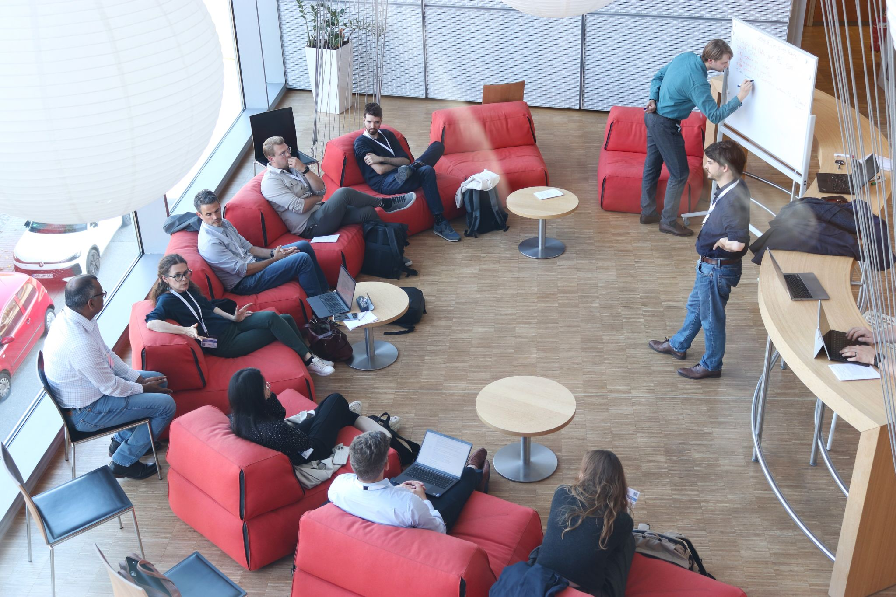

From **5 to 7 October 2026**, I attended the **Computational Simulation Lab Workshop 2026** at the TUM Institute for Advanced Study in Garching bei München, Germany. Hosted by TUM's Chair of Structural Analysis, led by **Prof. Roland Wüchner**, the workshop brought together researchers and industry professionals to exchange ideas and build connections around computational methods in engineering.

## Emerging methods and future research directions

On **6 October**, I **co-moderated Group H, “Emerging methods and future research directions”**, alongside Pierluigi D'Acunto, Qining Tang and Ricky Aristio. It was a rewarding opportunity to help guide a discussion with participants bringing different research interests, professional backgrounds and perspectives.

.](GroupH-My-working-group.jpeg){fig-alt="Participants gathered around a table during the Group H discussion, with a moderator standing beside a flipchart" width=70% fig-align="center"}

## A conversation across academia and industry

What I particularly enjoyed was the opportunity to meet people working in computational mechanics in different places and settings. Having both academic and industrial participants in the room made the exchange especially valuable.

{fig-alt="Workshop participants seated on red sofas around a whiteboard during a working-group discussion" width=70% fig-align="center"}

One of the questions that stayed with me was **how we transfer knowledge between academia and industry**. We do not always use the same language or work towards the same priorities, and a new method developed in a research setting does not automatically address an industrial need. Hearing these different perspectives prompted useful reflection on how we formulate research questions, communicate our results and connect numerical developments with practical applications.

**Kratos Multiphysics**, the open-source framework to which I contribute as a developer, was another recurring theme throughout the workshop. For me, its use in both academic research and industry made these conversations particularly relevant: shared software offers a concrete setting in which methods, experience and practical needs can meet.

**Pooyan Dadvand**, one of the main developers of Kratos Multiphysics, presented its *past, present and future*, offering a particularly relevant connection to the software that I help develop.

{fig-alt="Pooyan Dadvand speaking beside a projected title slide about the past, present and future of Kratos Multiphysics" width=70% fig-align="center"}

I came away with new connections and plenty to think about. Many thanks to the organisers, my fellow moderators and everyone who contributed to the discussions!

{fig-alt="Seven members of the CSL workshop community standing beside the event welcome banner outside the venue" width=70% fig-align="center"}

[Workshop website and programme](https://www.cee.ed.tum.de/en/st/cs-lab/events/csl-workshop-2026/) · [Download the workshop agenda (PDF)](CSL_Workshop_2026_A.GH.pdf) · [Kratos Multiphysics](https://github.com/KratosMultiphysics/Kratos)
