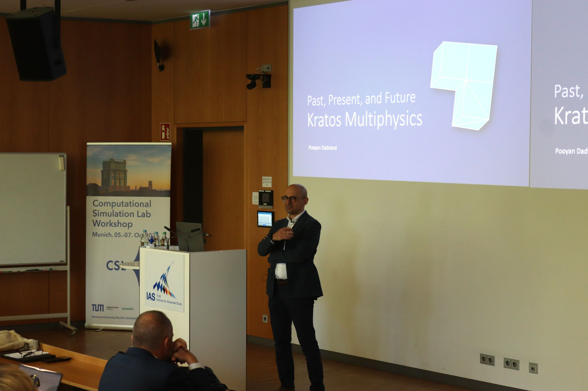
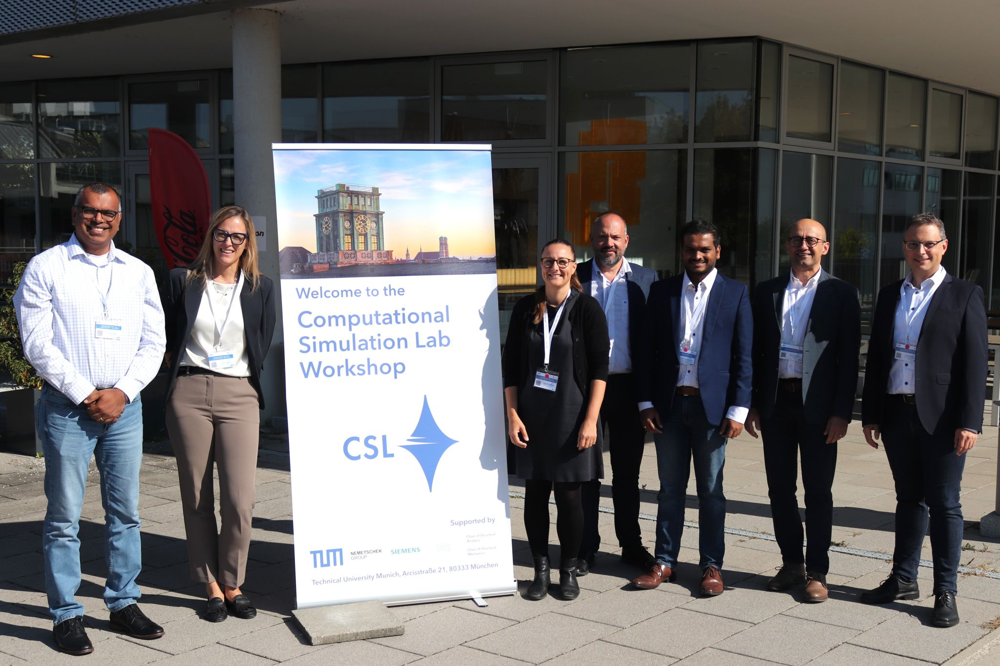

From **5 to 7 October 2026**, I attended the **Computational Simulation Lab Workshop 2026** at the TUM Institute for Advanced Study in Garching bei München, Germany. Hosted by TUM's Chair of Structural Analysis, led by **Prof. Roland Wüchner**, the workshop brought together researchers and industry professionals to exchange ideas and build connections around computational methods in engineering.

What I particularly enjoyed was the opportunity to meet people working in computational mechanics in different places and settings. Having both academic and industrial participants in the room made the exchange especially valuable.

.](Another-working-group.jpeg){fig-alt="Workshop participants seated on red sofas around a whiteboard during a working-group discussion" width=70% fig-align="center" .csl-workshop-photo}

One of the questions that stayed with me was **how we transfer knowledge between academia and industry**. We do not always use the same language or work towards the same priorities, and a new method developed in a research setting does not automatically address an industrial need. Hearing these different perspectives prompted useful reflection on how we formulate research questions, communicate our results and connect numerical developments with practical applications.

These questions also shaped the Group H discussion on “Emerging methods and future research directions”, which I co-moderated on 6 October alongside Pierluigi D'Acunto, Qining Tang and Ricky Aristio.

.](GroupH-My-working-group.jpeg){fig-alt="Participants gathered around a table during the Group H discussion, with a moderator standing beside a flipchart" width=70% fig-align="center" .csl-workshop-photo}

**Kratos Multiphysics**, the open-source framework to which I contribute as a developer, is one of the software platforms we know, use and contribute to as a workshop community. This shared experience made it an important point of connection: a common setting in which we develop methods, exchange knowledge and bring together academic research and industrial needs.

**Pooyan Dadvand**, one of the main developers of Kratos Multiphysics, presented its *past, present and future*, adding a broader perspective on the evolution of this shared framework.

{fig-alt="Pooyan Dadvand speaking beside a projected title slide about the past, present and future of Kratos Multiphysics" width=70% fig-align="center" .csl-workshop-photo}

We also discussed **AI agents** and how to integrate this technology thoughtfully into the way we develop new methods and write new code. These conversations raised questions about what good practice should look like as these tools become part of our development workflows.

I came away with new connections and plenty to think about. Many thanks to the organisers, my fellow moderators and everyone who contributed to the discussions!

{fig-alt="Seven members of the CSL workshop community standing beside the event welcome banner outside the venue" width=70% fig-align="center" .csl-workshop-photo}

[Workshop website and programme](https://www.cee.ed.tum.de/en/st/cs-lab/events/csl-workshop-2026/) · [Download the workshop agenda (PDF)](CSL_Workshop_2026_A.GH.pdf) · [Kratos Multiphysics](https://github.com/KratosMultiphysics/Kratos)

```{=html}
<nav class="news-navigation" aria-label="News navigation">
  <a class="news-navigation-previous" href="../2026-07-27-lituya-bay-tfg/index.qmd" rel="prev">
    <span class="news-navigation-label"><span aria-hidden="true">←</span> Previous news</span>
    <span class="news-navigation-title">Undergraduate thesis on numerical simulation of the Lituya Bay megatsunami · UA</span>
  </a>
  <a class="news-navigation-all" href="../../blog.qmd">All news</a>
</nav>
```
